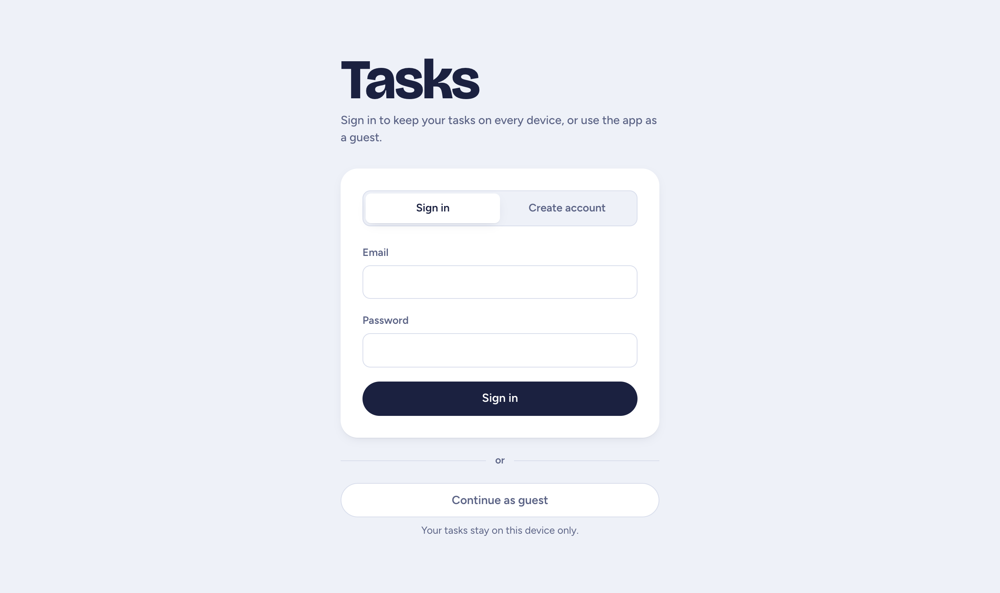

# Tasks

A simple Kanban task manager that runs in your browser. Use it as a guest, or create a free account to see your tasks on every device.

**Try it:** https://themasterdanny.github.io/task_manager/


## Two ways to use it

- **As a guest:** no sign up. Your tasks are saved in this browser, on this device.
- **With an account:** sign in with your email and your tasks follow you to your phone, laptop or any other browser.

Already using it as a guest? When you create an account, you can bring your tasks along.



## Features

- Organize tasks in **To do**, **In progress**, **Review** and **Done**
- Drag and drop cards between columns
- Set a priority and a due date; overdue tasks show in red
- Search and filter by priority
- Switch between board and list views
- Works on phones

| List view | Add or edit a task | Phone |
|---|---|---|
|  |  |  |

> **Good to know:** the server runs on a free plan and sleeps when nobody uses it. If the app hasn't been used for a while, the first sign in can take up to a minute.

## Run it locally

**Guest mode only** (no database needed):

```bash
npm install
npm run dev
```

Then open http://localhost:5173.

**With accounts**, also start the API in a second terminal. You'll need a Postgres database (a free one from [Neon](https://neon.tech) works):

```bash
cd server
npm install
cp .env.example .env   # then fill in your own values
npm run db:deploy      # creates the tables
npm run dev            # API at http://localhost:3000
```

## Built with

- **App:** React, TypeScript, Vite, Tailwind CSS and Zustand, hosted on GitHub Pages
- **API:** Node.js, Express and Prisma, hosted on Render
- **Database:** PostgreSQL on Neon

Passwords are hashed with argon2, sessions use signed tokens, and each account can only see its own tasks.
