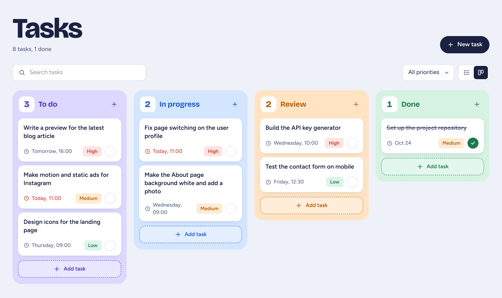
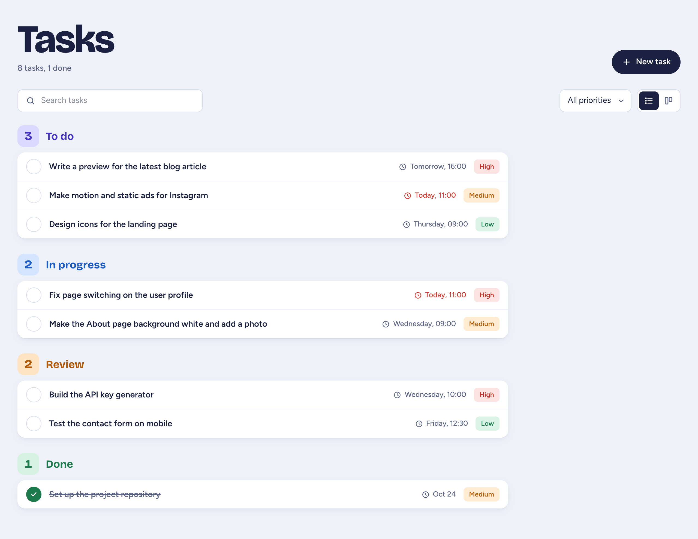
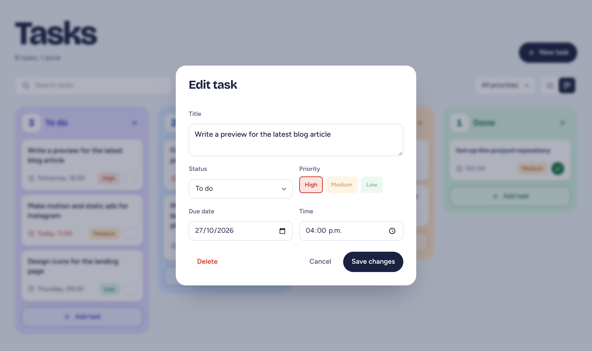
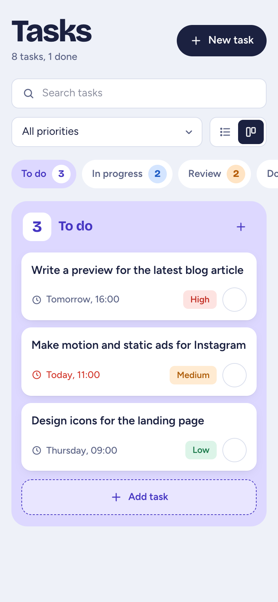

# Tasks

A simple Kanban task manager that runs in your browser. No account needed: your tasks are saved automatically.

**Try it:** https://themasterdanny.github.io/task_manager/



## Features

- Organize tasks in **To do**, **In progress**, **Review** and **Done**
- Drag and drop cards between columns
- Set a priority and a due date; overdue tasks show in red
- Search and filter by priority
- Switch between board and list views
- Works on phones

| List view | Add or edit a task | Phone |
|---|---|---|
|  |  |  |

> Tasks are saved in your browser's localStorage, so they stay on that browser and device.

## Run it locally

```bash
npm install
npm run dev
```

Then open http://localhost:5173.

## Built with

React, TypeScript, Vite, Tailwind CSS and Zustand. Every push to `main` deploys to GitHub Pages.
